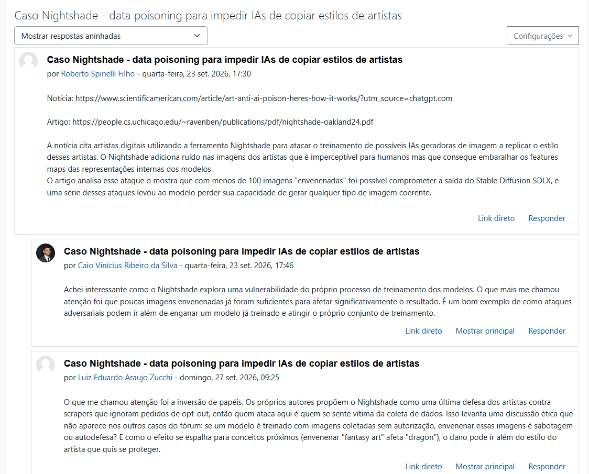

# PCS5917 – IA Adversarial

## Portfólio Individual

**Aluno:** Roberto Spinelli Filho  
**Disciplina:** PCS5917 – IA Adversarial  
**Período:** 3º período de 2026  
**Instituição:** Universidade de São Paulo – Escola Politécnica  
**Professor:** Victor Takashi Hayashi  

## Índice das aulas

- [Aula 1 — Notícias e referências científicas](#3-aula-1--notícias-e-referências-científicas)
- [Aula 2 — Red teaming manual de LLMs](#4-aula-2--red-teaming-manual-de-llms)
- [Aula 3 — Detecção de áudio falso](#5-aula-3--detecção-de-áudio-falso)
- Aulas 4 a 7: seções e artefatos serão acrescentados conforme as atividades.

## 1. Objetivo do Portfólio

Este portfólio reúne as principais atividades, estudos, experimentos e reflexões desenvolvidos ao longo da disciplina **PCS5917 – IA Adversarial**.

O objetivo é documentar individualmente o processo de aprendizagem sobre:

- notícias e referências científicas sobre IA Adversarial (Aula 1);
- fundamentos de Inteligência Artificial e Segurança (Aula 2);
- aplicação de IA em cibersegurança (Aula 3);
- ataques adversariais contra sistemas de IA (Aulas 4 e 5);
- avaliação de ataques e uso de LLMs como juiz (Aula 6);
- defesas em Large Language Models (Aula 7).

Os experimentos realizados durante as aulas devem ser complementados por registros individuais, notebooks, respectivos resultados e referências bibliográficas (citações).

## 2. Organização do Repositório

**IMPORTANTE**: somente branch main (demais branches serão desconsideradas na correção).
Faça o desenvolvimento incremental com **commits semanais**, pois a evolução durante as semanas também é critério de avaliação.
Organize seu README focando em ser objetivo, com evidências de resultados e citações às referências utilizadas.

```text
.
├── README.md
├── notebooks/                      # Notebooks entregáveis com saídas
│   ├── aula-02-llm-jailbreaks.ipynb
│   └── ...
├── images/
│   ├── aula-01/
│   ├── aula-02/
│   └── aula-03/
└── outros/
    ├── aula-02-ataque-manual/
    │   ├── requirements.txt
    │   ├── compilar_resultados.py
    │   ├── dados/                  # Dataset baixado localmente
    │   └── resultados/             # CSVs, JSONL, referências e versões no Git
    └── aula-03-deteccao-audio-falso/
        ├── preparar_subconjunto.py
        ├── dados/                  # Metadados e subconjuntos existentes
        └── resultados/
```

## 3. Aula 1 – Notícias e referências científicas

Atividade no fórum da disciplina: discussão da notícia e do artigo sobre **Nightshade**, ferramenta de *data poisoning* usada por artistas digitais para impedir que modelos geradores de imagem copiem seus estilos.

**Referências:**
- Notícia: [Scientific American – How art anti-AI poison works](https://www.scientificamerican.com/article/art-anti-ai-poison-heres-how-it-works/?utm_source=chatgpt.com)
- Artigo: [Nightshade (Oakland 2024)](https://people.cs.uchicago.edu/~ravenben/publications/pdf/nightshade-oakland24.pdf)



## 4. Aula 2 – Red teaming manual de LLMs

Notebook: [aula-02-llm-jailbreaks.ipynb](notebooks/aula-02-llm-jailbreaks.ipynb). Dependências: [requirements.txt](outros/aula-02-ataque-manual/requirements.txt).

Experimento preparado para execução local em RTX 4090 (24 GB), autorizada pelo professor conforme relato do aluno, com **DeepSeek-R1-Distill-Qwen-14B em NF4 de 4 bits**. O notebook compara pedidos diretos e ataques manuais baseados no [Self-Reminder-Data](https://github.com/yjw1029/Self-Reminder-Data/blob/master/data/jailbreak_prompts.csv), em português e inglês, e registra revisões, parâmetros, consumo de VRAM e avaliações humanas.

**Status:** execução local iniciada; avaliações e discussão em andamento. Salvar as saídas, adicionar capturas em `images/aula-02/` e relatar aqui os resultados observados e suas limitações. As instruções de instalação estão no notebook.

Referências: [modelo oficial](https://huggingface.co/deepseek-ai/DeepSeek-R1-Distill-Qwen-14B) e [quantização com bitsandbytes](https://huggingface.co/docs/transformers/quantization/bitsandbytes).


Os arquivos para avaliação ficam em [resultados da aula 2](outros/aula-02-ataque-manual/resultados/README.md):

- [Tentativas compiladas](outros/aula-02-ataque-manual/resultados/tentativas-compiladas.csv): uma linha por tentativa, incluindo prompt, resposta, parâmetros e avaliação.
- [Estatísticas compiladas](outros/aula-02-ataque-manual/resultados/estatisticas-compiladas.csv): contagens e taxas por configuração, idioma, template e condição.

Os CSVs compilados refletem as tentativas gravadas; avaliações pendentes aparecem como `pending`. Após gerar e avaliar as respostas, execute a exportação no notebook. Tentativas, avaliações e CSVs compilados devem ser incluídos no Git junto com as evidências.

## 5. Aula 3 – Detecção de áudio falso

Material de apoio: [pasta da atividade](outros/aula-03-deteccao-audio-falso/README.md). Preparação dos dados: [script](outros/aula-03-deteccao-audio-falso/preparar_subconjunto.py) e [subconjunto de 288 áudios](outros/aula-03-deteccao-audio-falso/dados/subconjunto_288/README.md). Notebook, resultados e análise serão acrescentados após a execução da atividade.

Referência: [ASVspoof no Kaggle](https://www.kaggle.com/datasets/ulianazb/asvspoof-2024).

## Disclaimer de Uso Ético

Este repositório foi desenvolvido exclusivamente para fins acadêmicos e de pesquisa no contexto da disciplina **PCS5917 – IA Adversarial**.

Alguns experimentos, datasets, prompts, códigos e resultados apresentados podem conter **conteúdo potencialmente malicioso**, incluindo exemplos de jailbreaks, payloads e outras técnicas de ataque. Esses materiais são disponibilizados para fins de estudo, análise, reprodução controlada e compreensão de mecanismos de ataque e defesa.

Os conteúdos devem ser utilizados somente em **ambientes autorizados e controlados**, sem direcionamento a sistemas, modelos, redes, dispositivos ou usuários de terceiros. A reprodução dos experimentos deve respeitar as políticas de uso das ferramentas e os termos das plataformas utilizadas.

O conteúdo deste repositório **não constitui recomendação ou incentivo à realização de atividades maliciosas**. O objetivo é compreender riscos de segurança, desenvolver métodos de avaliação e contribuir para o desenvolvimento de sistemas de Inteligência Artificial mais seguros.
